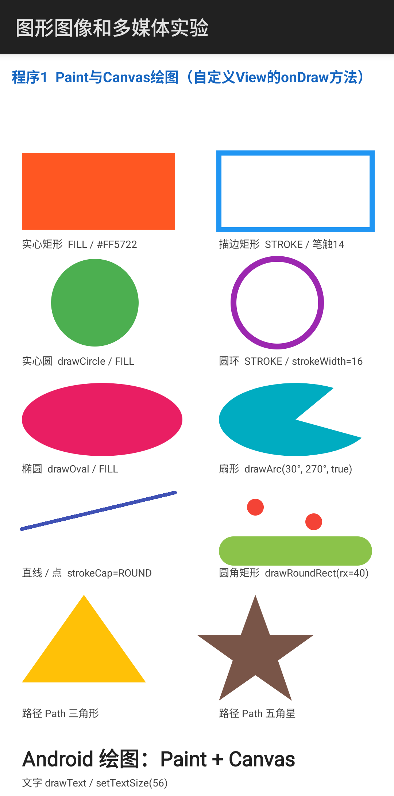
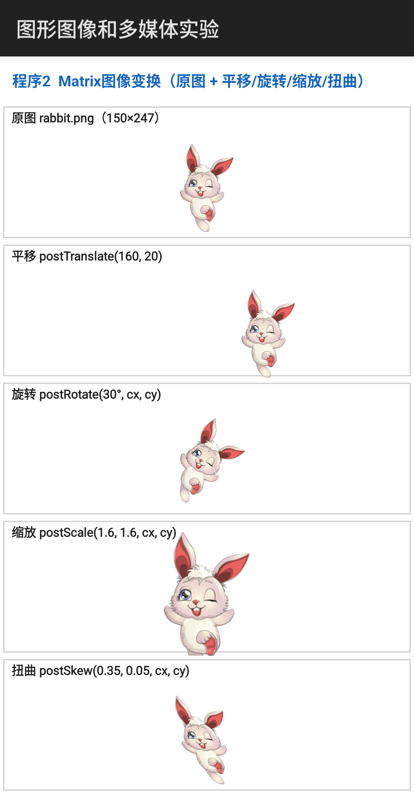
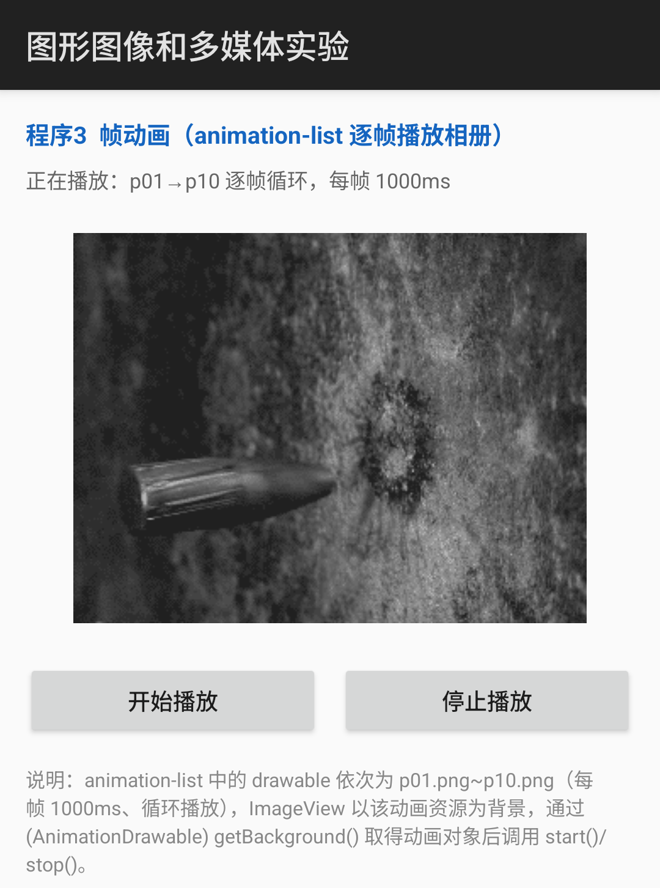
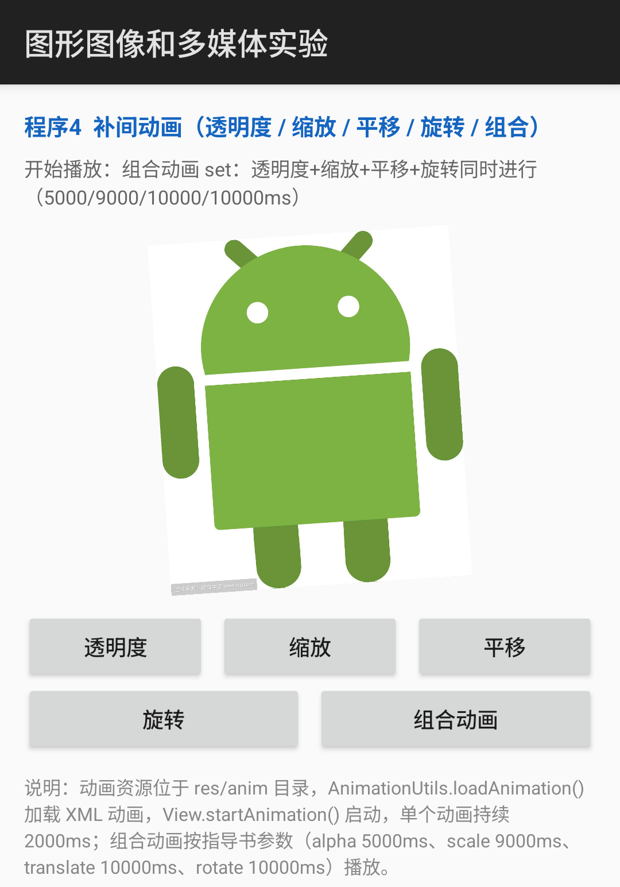
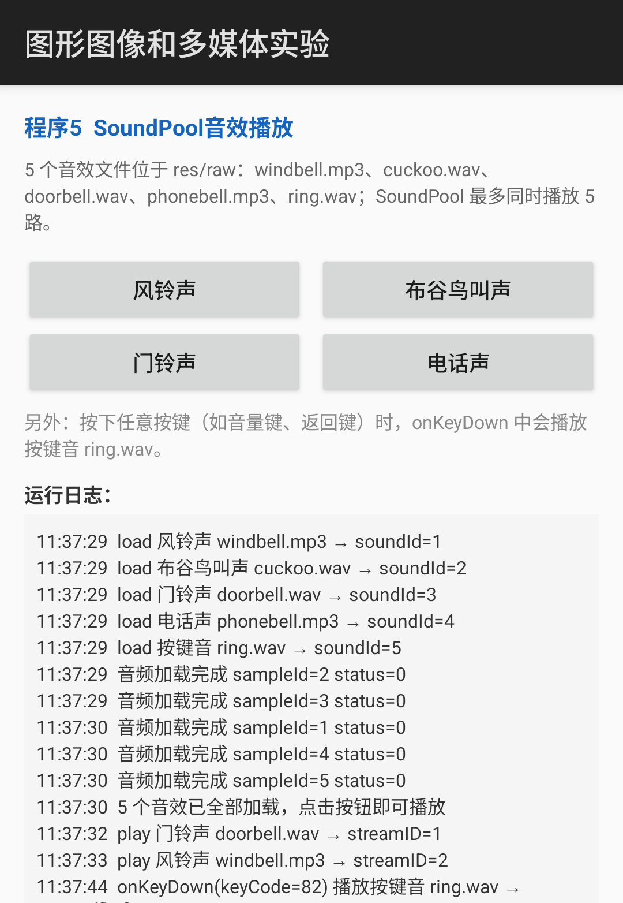
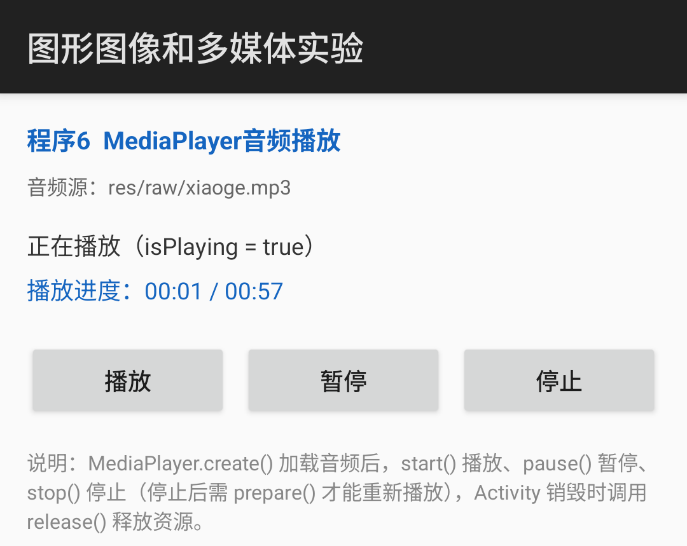
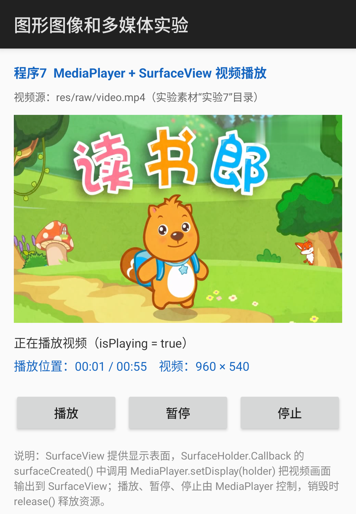
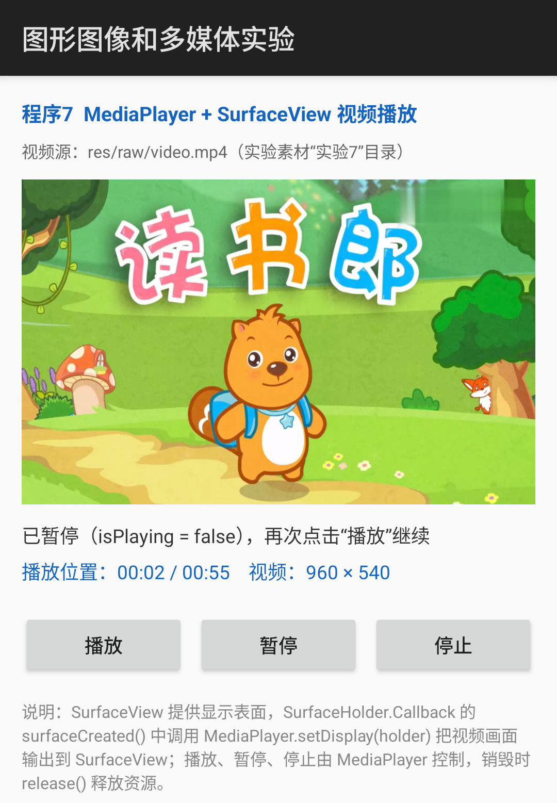

# 移动终端软件开发 · 实验四：图形图像和多媒体技术

Android 端七个程序的完整实现（Paint 与 Canvas 绘图、Matrix 图像变换、帧动画、补间动画、
SoundPool 音效、MediaPlayer 音频、MediaPlayer + SurfaceView 视频）、运行截图和实验报告（答题卡）。

- 学生：胡俊峰
- 学号：202402323
- 班级：计算机249
- 实验指导书：实验四 图形图像和多媒体技术
- 报告日期：2026.11.06

## 实验内容

| 程序 | 知识点 | 实现说明 |
| --- | --- | --- |
| 程序 1 | Paint 与 Canvas 绘图 | 自定义 `ShapeView` 重写 `onDraw()`，绘制实心/描边矩形、圆/圆环、椭圆/扇形、直线/点、圆角矩形、路径（三角形/五角星）与文本，并标注图形类型与画笔属性 |
| 程序 2 | Matrix 图像变换 | 自定义 `MatrixView` 在同一画布上分 5 个面板显示原图 rabbit.png 与平移（postTranslate）、旋转（postRotate）、缩放（postScale）、扭曲（postSkew）结果 |
| 程序 3 | 帧动画 | `res/anim/album_list.xml`（animation-list，10 帧 p01~p10，每帧 1000ms，oneshot=false 循环），`AnimationDrawable.start()/stop()` 控制 |
| 程序 4 | 补间动画 | `res/anim` 下 alpha/scale/translate/rotate 四个动画 + `anim_set.xml` 组合动画（按指导书 5000/9000/10000/10000ms），`AnimationUtils.loadAnimation()` + `startAnimation()` |
| 程序 5 | SoundPool 音效 | Builder 方式初始化（最多 5 路），异步 `load()` 5 个音效（windbell.mp3、cuckoo.wav、doorbell.wav、phonebell.mp3、ring.wav），4 个按钮 + `onKeyDown` 按键音，界面日志记录加载与播放结果，`release()` 释放 |
| 程序 6 | MediaPlayer 音频 | `MediaPlayer.create()` 加载 res/raw/xiaoge.mp3，播放/暂停/停止（stop 后 prepare 再播放），Handler 每 500ms 刷新进度，`release()` 释放 |
| 程序 7 | MediaPlayer + SurfaceView 视频 | `SurfaceHolder.Callback` + `setDisplay(holder)` 关联显示表面，播放/暂停/停止，res/raw/video.mp4（960×540、55s），`release()` 释放 |

## 运行环境

- Android Studio（Gradle 8.11.1 + AGP 8.7.3，Java 21）
- compileSdk 35 / minSdk 24 / targetSdk 34
- 模拟器：Pixel 7（API 35，Android 15），1080×2400
- 截图由 `adb shell screencap` 采集，`tools/crop_shots.py` 裁剪

## 目录结构

```
android/Lab4GraphicsMedia/                 Android 工程源码（Java）
  app/src/main/java/com/example/graphicsmedia/
    MainActivity.java                      七个程序的入口菜单
    PaintCanvasActivity.java + ShapeView.java        程序1 Canvas 绘图
    MatrixActivity.java + MatrixView.java            程序2 Matrix 变换
    FrameAnimActivity.java                           程序3 帧动画
    TweenAnimActivity.java                           程序4 补间动画
    SoundPoolActivity.java                           程序5 SoundPool 音效
    AudioPlayerActivity.java                         程序6 MediaPlayer 音频
    VideoPlayerActivity.java                         程序7 MediaPlayer + SurfaceView 视频
  app/src/main/res/
    layout/                                各程序的界面布局
    anim/album_list.xml + alpha/scale/translate/rotate/anim_set.xml   动画资源
    drawable-nodpi/                        rabbit.png、p01~p10.png、bigandroid.png
    raw/                                   windbell.mp3、cuckoo.wav、doorbell.wav、
                                           phonebell.mp3、ring.wav、xiaoge.mp3、video.mp4
screenshots/                              adb 原始截图
screenshots/crops/                        报告用的裁剪截图
report/
  实验四、图形图像和多媒体技术-202402323-胡俊峰.docx   答题卡（可编辑）
  实验四、图形图像和多媒体技术-202402323-胡俊峰.pdf    提交用实验报告
docs/答题卡.docx                           原始答题卡模板
docs/指导书.pdf                            实验指导书
content_lab4.py                           报告正文内容（代码片段、截图清单、思考题答案、小结）
fill_report.py                            将内容填入答题卡模板
tools/crop_shots.py                       运行截图裁剪脚本
```

## 构建与运行

```bash
# 在 Android Studio 中打开 android/Lab4GraphicsMedia 并运行 app
# 或命令行构建（需先在 android/Lab4GraphicsMedia 下创建 local.properties，内容为 sdk.dir=你的SDK路径）
cd android/Lab4GraphicsMedia
./gradlew assembleDebug

# 安装并启动
adb install -r app/build/outputs/apk/debug/app-debug.apk
adb shell am start -n com.example.graphicsmedia/.MainActivity
# 也可直接启动单个程序：
adb shell am start -n com.example.graphicsmedia/.PaintCanvasActivity
adb shell am start -n com.example.graphicsmedia/.MatrixActivity
adb shell am start -n com.example.graphicsmedia/.FrameAnimActivity
adb shell am start -n com.example.graphicsmedia/.TweenAnimActivity
adb shell am start -n com.example.graphicsmedia/.SoundPoolActivity
adb shell am start -n com.example.graphicsmedia/.AudioPlayerActivity
adb shell am start -n com.example.graphicsmedia/.VideoPlayerActivity
```

## 生成实验报告

```bash
# 1) 裁剪截图（需 Pillow）
python tools/crop_shots.py

# 2) 把代码、截图、思考题答案填入答题卡模板
python fill_report.py

# 3) docx 转 pdf（LibreOffice Kit）
```

## 运行截图

| 程序1 绘图 | 程序2 Matrix | 程序3 帧动画 |
| --- | --- | --- |
|  |  |  |

| 程序4 补间动画 | 程序5 音效 | 程序6 音频 |
| --- | --- | --- |
|  |  |  |

| 程序7 视频（播放） | 程序7 视频（暂停） |
| --- | --- |
|  |  |

更多截图见 [`screenshots/`](screenshots/)（原始全屏截图）与 [`screenshots/crops/`](screenshots/crops/)（报告中使用的裁剪图）。

## 实验报告

- PDF（提交用）：[report/实验四、图形图像和多媒体技术-202402323-胡俊峰.pdf](report/实验四、图形图像和多媒体技术-202402323-胡俊峰.pdf)
- 可编辑源文件：[report/实验四、图形图像和多媒体技术-202402323-胡俊峰.docx](report/实验四、图形图像和多媒体技术-202402323-胡俊峰.docx)

报告按答题卡原有版式填写：七个程序的关键代码、运行截图与标注、2.1 节 8 道思考题答案、2.2 节实验小结（问题与解决、收获体会、不足与改进）。

> 说明：`local.properties`（记录本机 Android SDK 路径）不纳入版本库；用 Android Studio 打开工程时会自动生成。
> 视频素材（素材“实验7”目录中的 video.mp4）放在 `res/raw/video.mp4` 中，便于随 APK 一起安装；
> 指导书中示例用的是 SD 卡路径（/sdcard/beargolf.mp4），如需演示 SD 卡方式，可把 `MediaPlayer.create(...)`
> 换成 `setDataSource("/sdcard/xxx.mp4")` + `prepare()`。
